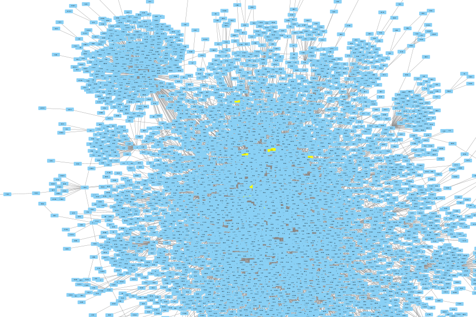

# Graph algorithms

In class we discussed the breadth-first and depth-first tecniques to
search graphs. This repository implements both, and uses one to test if
a path can be found in a graph from a source vertex to a target
vertex.

```
$ g++ -o main --std=c++20 main.cpp AdjacencyLists.cpp 
$ ./main small.csv 1 8
Found a path from 1 to 8
```

## Example graphs

 - small.csv - An 8 vertex sample
 - tree.csv - The 7 vertex binary tree from class
 - unique-graph.csv - a large (50,000) vertex graph from ssb social network
 - unique-graph-10k.csv - a random sample of 10,000 edges from the ssb social network

## Social networks



Social networks can grow very large. The above graph is a portion of
the social network graph of an obscure social network, secure
scuttlebutt. The full graph has 54,153 vertices and 364,801 edges (see
`unique-graph.csv`).

## Exercise

The textbook discusses finding shortest paths in a graph by running a
modified breadth-first search using an auxiliary array `p` (see
section 12.3.1). Write a function to print the shortest path in a
given graph `g` from a source vertex `r` to a target vertex `t`.

```
template<class Graph>
bool print_path(Graph &g, int r, int t);
```

